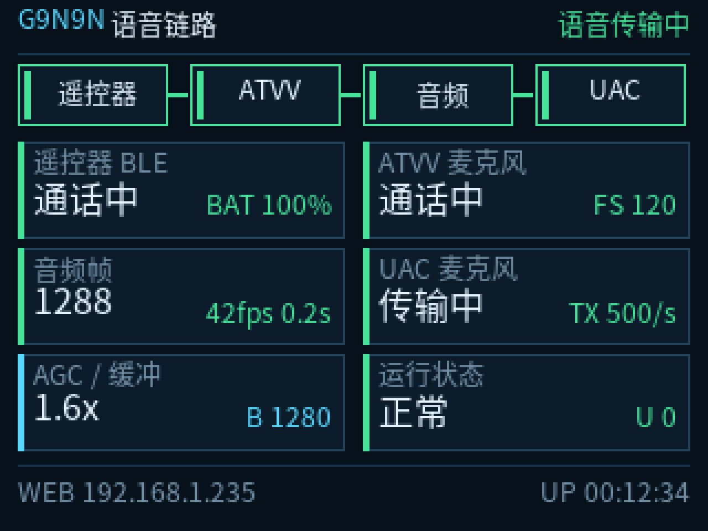

# ES3C28P RemoteMapper for G9N9N

把 G9N9N / Chromecast Remote 变成一个带屏幕诊断能力的 USB 语音与快捷键桥：

- BLE 连接遥控器
- HID 按键映射与多层宏
- ATVV 语音音频转 USB UAC 麦克风
- ES3C28P 320x240 状态屏
- Wi-Fi 网页配置与 OTA



> 当前仓库是**私有整理版**。上游 `RemoteMapper-ESP32` 的 README 声称使用
> MIT，但上游仓库没有实际的 `LICENSE` 文件。确认许可证前不会把本仓库
> 改成 Public，也不会替上游补写许可证。

## 硬件

| 项目 | 参数 |
|---|---|
| MCU | ESP32-S3 N16R8 |
| Flash | 16MB |
| PSRAM | 8MB Octal |
| 屏幕 | 320x240 ILI9341，SPI |
| 遥控器 | G9N9N / Windows 枚举名 `Chromecast Remote` |
| PC 连接 | 原生 USB：HID + UAC + CDC |

LCD 引脚：

```text
SCLK GPIO12
MOSI GPIO11
MISO GPIO13
CS   GPIO10
DC   GPIO46
BL   GPIO45
```

## 功能

### USB

Windows 会枚举：

- HID 键盘
- Consumer Control
- `RemoteMapper Wireless Microphone`
- CDC 串口

### G9N9N

- HID 按键索引 `1..17`
- 5 层映射
- 单击、长按、双击
- 网页改键、配置导入导出、NVS 保存
- ATVV 语音键 `0xFE`

默认语音组合键是右 Ctrl + 右 Alt，用于豆包等长按说话的输入法。

### 语音链路

```text
G9N9N 语音键
  -> BLE ATVV
  -> ESP32-S3 IMA ADPCM 解码
  -> 滤波 / AGC
  -> USB UAC 麦克风
  -> Windows / 豆包输入法
```

### 状态屏

屏幕每秒刷新：

- 遥控器 BLE 状态与电量
- ATVV 麦克风状态与帧尺寸
- 音频帧、帧率、最近收帧时间
- UAC 挂载、传输状态和速率
- AGC 增益、缓冲量、欠载计数
- Web 地址与运行时间

长时间空闲时，固件每分钟轻量刷新 ATVV 订阅并查询 CAPS；链路状态、AUD/CTL
订阅或语音会话异常会自动恢复。诊断字段和恢复策略见
[IDLE_VOICE_RECOVERY.md](IDLE_VOICE_RECOVERY.md)。

## 编译

```powershell
python -m venv .venv
& '.venv\Scripts\python.exe' -m pip install platformio
& '.venv\Scripts\pio.exe' run -e esp32s3_n16r8
```

如果 Windows 源码路径包含非 ASCII 字符，请把项目放到纯 ASCII 路径再编译。

原生测试：

```powershell
C:\Python314\python.exe test\native\test_suite.py
```

## 安全烧录

当前设备沿用原厂小智 bootloader 与分区表，只允许写两个应用槽：

```text
0x0020000  firmware.bin
0x0410000  firmware.bin
```

不要写：

```text
0x0000000  bootloader
0x0008000  partition table
0x0009000  NVS / Wi-Fi credentials
```

详细步骤见 [docs/SAFE_FLASHING.md](docs/SAFE_FLASHING.md)。

## 状态 API

```text
GET http://remotemapper.local/api/status
GET http://remotemapper.local/api/logs
```

关键字段：

```text
ble_state
atvv_audio_ready
last_audio_age_ms
frames_decoded
samples_pushed
uac_mounted
uac_streaming
uac_transfers
agc_gain
audio_underruns
```

## 使用

1. 用数据线连接开发板原生 USB 口。
2. 在豆包输入法中选择 `RemoteMapper Wireless Microphone`。
3. 保持语音快捷键为右 Ctrl + 右 Alt。
4. 按住遥控器语音键说话，松开后等待文字上屏。

遥控器同一时间只能连接一个主机。如果它已经连接到 Windows 蓝牙，先在
Windows 中删除 `Chromecast Remote`。

## 目录

```text
src/                固件源码
include/            公共头文件与状态屏字体
test/native/        可在 PC 运行的原生测试
pc_companion/       Windows 配套脚本
tools/              字体与状态屏预览工具
docs/               安全刷写和状态屏说明
```

## 来源与许可证

本项目基于：

[cuicui-V5/RemoteMapper-ESP32](https://github.com/cuicui-V5/RemoteMapper-ESP32)

上游 README 声称 MIT，但截至整理时仓库没有实际 `LICENSE` 文件。
许可证状态见 [LICENSE_STATUS.md](LICENSE_STATUS.md)。

本项目与 Google、Xiaomi、Doubao 或其他商标所有者没有隶属关系。
